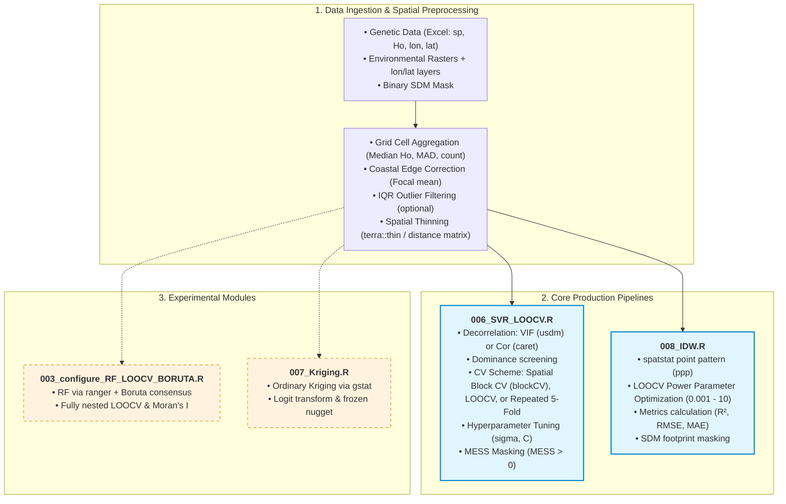

# Spatial Macrogenetics Prediction Workflows

[](https://www.r-project.org/)
[](https://opensource.org/licenses/MIT)
[](#)

An R analytical framework for continuous spatial prediction of genetic diversity metrics (e.g., observed heterozygosity, $H_o$) across a species' geographical distribution. This repository integrates machine learning regression models, spatial interpolation methods, feature selection routines, cross-validation strategies, and environmental extrapolation masking.

---

## Workflow Overview

The framework provides two **core production pipelines** along with two **experimental/alternative modules**:

### Core Production Pipelines
1. **Support Vector Regression (`006_SVR_LOOCV.R` / `svr_ho_pipeline`)**: A robust machine learning workflow using radial (`svmRadial`) or linear (`svmLinear`) SVR kernels via `caret` and `kernlab`. It features predictor decorrelation via VIF stepwise filtering (`usdm::vifstep`) or Pearson correlation cutoffs (`caret::findCorrelation`), grid cell-level aggregation, IQR outlier removal, spatial thinning (`terra::thin`), multiple cross-validation strategies (Spatial Block CV via `blockCV`, LOOCV, or Repeated 5-Fold CV), and Multivariate Environmental Similarity Surface (MESS) masking.
2. **Inverse Distance Weighting (`008_IDW.R` / `run_idw_analysis`)**: A deterministic spatial interpolation workflow utilizing `spatstat`. It automates the optimization of the IDW power parameter ($\alpha$) via Leave-One-Out Cross-Validation (LOOCV), evaluates predictive metrics ($R^2$, RMSE, MAE), incorporates spatial thinning, and generates high-resolution prediction rasters constrained by Species Distribution Model (SDM) binary footprints.

### Experimental / Alternative Pipelines
> [!NOTE]
> The following scripts are maintained as experimental modules for comparative methodology:
> - **Random Forest with Boruta (`003_configure_RF_LOOCV_BORUTA.R` / `RF_LOOCV`)**: `ranger`-based Random Forest with iterative Boruta variable selection and nested LOOCV.
> - **Ordinary Kriging (`007_Kriging.R` / `ordinary_kriging_ho_pipeline_v8`)**: Geostatistical interpolation pipeline using `gstat` with Logit transformation, rigid nugget constraints to prevent overfitting, and empirical semivariogram fitting.

---

## Architectural Flow



---

## Core Pipelines Detail

### 1. Support Vector Regression Pipeline (`006_SVR_LOOCV.R`)

The `svr_ho_pipeline` function executes an end-to-end Support Vector Machine regression tailored for spatial genetic metrics:

```r
svr_ho_pipeline(
  outdir,
  sp_name,
  raster_dir,
  data_path,
  sdm_path,
  n_cores       = 6L,
  decorr_method = c("vif", "cor"),
  vif_th        = 10,
  cor_cutoff    = 0.5,
  addLonLat     = FALSE,
  use_loocv     = FALSE,
  use_blockcv   = FALSE,
  remove_outliers = FALSE,
  iqr_mult      = 1.5,
  kernel_type   = "svmRadial",
  thin_dist     = 3000
)
```

**Key Parameters**:
- `decorr_method`: Choose `"vif"` (`usdm::vifstep`) or `"cor"` (`caret::findCorrelation`) to eliminate collinear predictors.
- `vif_th` / `cor_cutoff`: Variance Inflation Factor threshold (default `10`) or absolute Pearson $|r|$ cutoff (default `0.5`).
- `addLonLat`: If `TRUE`, geographic coordinates (`lon`, `lat`) are added as explicit predictors.
- `use_blockcv` / `use_loocv`: Validation mode selection. Setting `use_blockcv = TRUE` enforces Spatial Block CV via `blockCV` (requires $n \ge 49$ aggregated cells). Setting `use_loocv = TRUE` performs Leave-One-Out CV. If both are `FALSE`, Repeated 5-Fold CV (10 repeats) is executed.
- `remove_outliers` & `iqr_mult`: Filters cell-level $H_o$ values beyond the $[Q_1 - k \cdot \text{IQR}, Q_3 + k \cdot \text{IQR}]$ fence.
- `thin_dist`: Minimum spatial thinning distance in meters applied via `terra::thin`.
- `kernel_type`: Supports `"svmRadial"` (tuning $\sigma$ and $C$) or `"svmLinear"` (tuning $C$).

---

### 2. Inverse Distance Weighting Pipeline (`008_IDW.R`)

The `run_idw_analysis` function provides a spatial deterministic baseline with automated hyperparameter tuning:

```r
run_idw_analysis(
  sp_name,
  data_path,
  sdm_path,
  outdir,
  suffix          = "_IDW",
  remove_outliers = FALSE,
  iqr_mult        = 1.5,
  thinning        = FALSE,
  thin_dist_km    = 0
)
```

**Key Parameters**:
- `sp_name`: Scientific species name filtering the genetic dataset.
- `remove_outliers` & `iqr_mult`: Grid cell outlier filtering based on Interquartile Range.
- `thinning` & `thin_dist_km`: Distance-based spatial thinning in kilometers.
- `suffix`: File naming identifier automatically formatted according to scenario settings.

**Analytical Steps**:
1. Spatial aggregation by SDM raster cells.
2. LOOCV optimization of the IDW weighting exponent ($\alpha \in [0.001, 10]$) using `spatstat.explore::idw`.
3. Validation metrics extraction ($R^2$, RMSE, MAE) and performance plotting.
4. Export of interpolated rasters masked to the SDM footprint, high-resolution PDF maps via `tmap`, and `.RData` environments.

---

## Experimental Modules

- **`003_configure_RF_LOOCV_BORUTA.R` (`RF_LOOCV`)**: Random Forest regression using `ranger` with multi-seed Boruta feature selection, hyperparameter tuning, fully nested LOOCV, and Moran's $I$ spatial autocorrelation check on residuals.
- **`007_Kriging.R` (`ordinary_kriging_ho_pipeline_v8`)**: Ordinary Kriging with a Logit transformation for bounded variables ($0 < H_o < 1$), rigid nugget parameter locking to control overfitting, and semivariogram fitting across Spherical, Exponential, and Gaussian candidate models.

---

## Input Requirements

1. **Genetic Data Workbook (`data_path`)**: Excel spreadsheet (`.xlsx`) with a sheet named `"data"` containing:
   - `sp`: Scientific name string (e.g., `"Crocodylus moreletii"`).
   - `Ho`: Continuous genetic response variable (Observed Heterozygosity, $H_o > 0$).
   - `lon`, `lat`: Georeferenced point coordinates in standard WGS84 (EPSG:4326).
2. **Predictor Rasters (`raster_dir`)**: Folder with GeoTIFF files (`.tif`). Must include layers named `lon.tif` and `lat.tif` alongside environmental predictors (e.g., WorldClim bioclimatic layers).
3. **Binary SDM Raster (`sdm_path`)**: Binary species distribution model mask ($1 = \text{suitable habitat}, 0/\text{NA} = \text{masked}$).

---

## Dependencies & Installation

To install all required dependencies, execute in R:

```r
install.packages(c(
  "terra", "sf", "dplyr", "readxl", "caret", "doParallel", 
  "kernlab", "yardstick", "ggplot2", "ggpmisc", "patchwork", 
  "raster", "dismo", "usdm", "RColorBrewer", "tmap", "blockCV", 
  "spatstat", "spatstat.explore", "Metrics"
))

# Required for experimental modules:
install.packages(c("ranger", "Boruta", "ape", "gstat", "rnaturalearth"))
```

---

## Example Usage

### Running SVR Production Pipeline (`006_SVR_LOOCV.R`)

```r
source("006_SVR_LOOCV.R")

svr_ho_pipeline(
  outdir          = "results/CM_SVR_VIF_BLOCKCV",
  sp_name         = "Crocodylus moreletii",
  raster_dir      = "data/rasters_30s",
  data_path       = "data/Tabla_to_model.xlsx",
  sdm_path        = "data/ENMeval/CM_Binary_P10.tif",
  n_cores         = 6L,
  decorr_method   = "vif",
  vif_th          = 10,
  addLonLat       = FALSE,
  use_blockcv     = TRUE,
  use_loocv       = FALSE,
  remove_outliers = TRUE,
  iqr_mult        = 1.5,
  kernel_type     = "svmRadial",
  thin_dist       = 15000
)
```

### Running IDW Production Pipeline (`008_IDW.R`)

```r
source("008_IDW.R")

idw_metrics <- run_idw_analysis(
  sp_name         = "Crocodylus moreletii",
  data_path       = "data/Tabla_to_model.xlsx",
  sdm_path        = "data/ENMeval/CM_Binary_P10.tif",
  outdir          = "results/CM_IDW_THIN15KM",
  remove_outliers = TRUE,
  iqr_mult        = 1.5,
  thinning        = TRUE,
  thin_dist_km    = 15
)
```

---

## Standardized Output Files

Each pipeline execution outputs standardized results into the designated directory:

- **Metrics Tables (`.csv`)**: Predictive statistics ($R^2$, RMSE, MAE), model configuration settings, decorrelation results, and observed vs. predicted cross-validation values.
- **Diagnostic Figures (`.png`)**: Scatter plots of observed vs. predicted values for training resubstitution and cross-validation test folds with linear fit equations.
- **Spatial Rasters (`.tif`)**: Continuous predicted $H_o$ rasters constrained by the SDM footprint and MESS mask ($MESS > 0$).
- **Publication-Ready Maps (`.pdf`)**: Vector maps rendered with `tmap` displaying grid cells, occurrences, and predicted continuous gradients.
- **R Environment (`.RData`)**: Complete workspace snapshot for post-hoc analysis.

---

## Authors & Citation

- **Chrystian C. Sosa**
- **Jorge Gómez-Marulanda**
- **Victor Hugo García-Merchán**

**Methodological Reference**:
Sosa, C.C.; Arenas, C.; García-Merchán, V.H. *Human Population Density Influences Genetic Diversity of Two Rattus Species Worldwide: A Macrogenetic Approach*. Genes 2023, 14, 1442. https://doi.org/10.3390/genes14071407